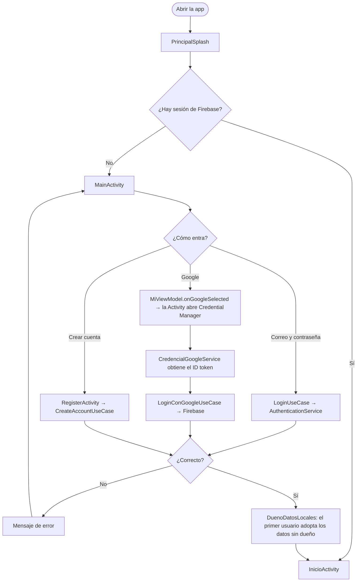
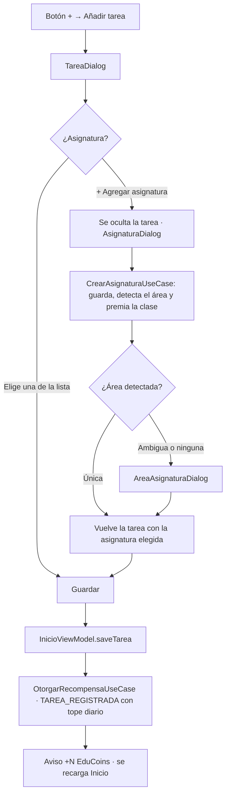
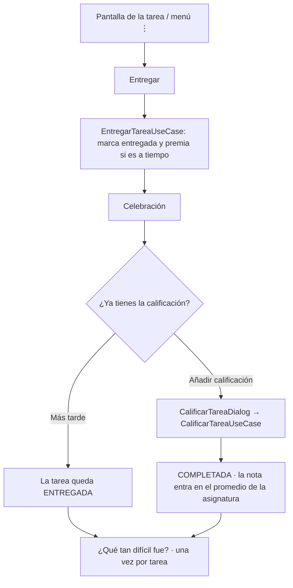
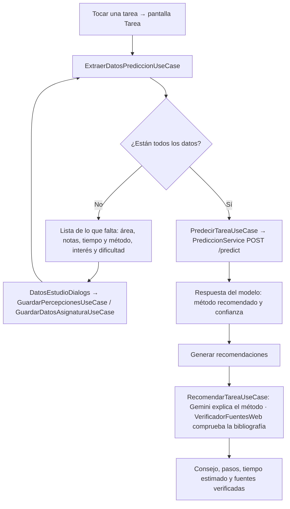
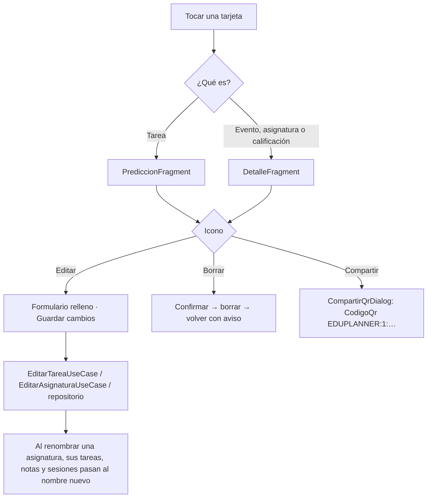
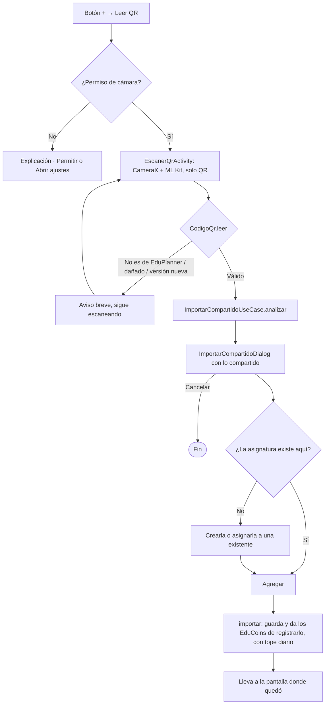
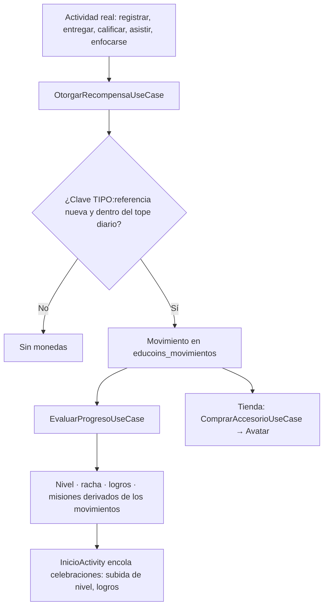
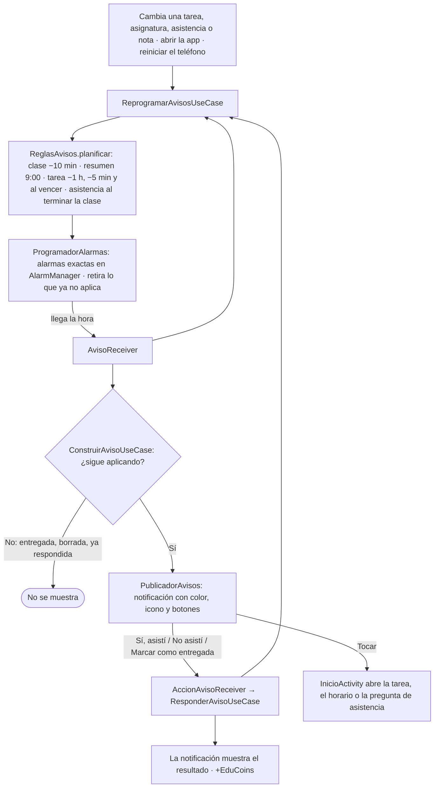
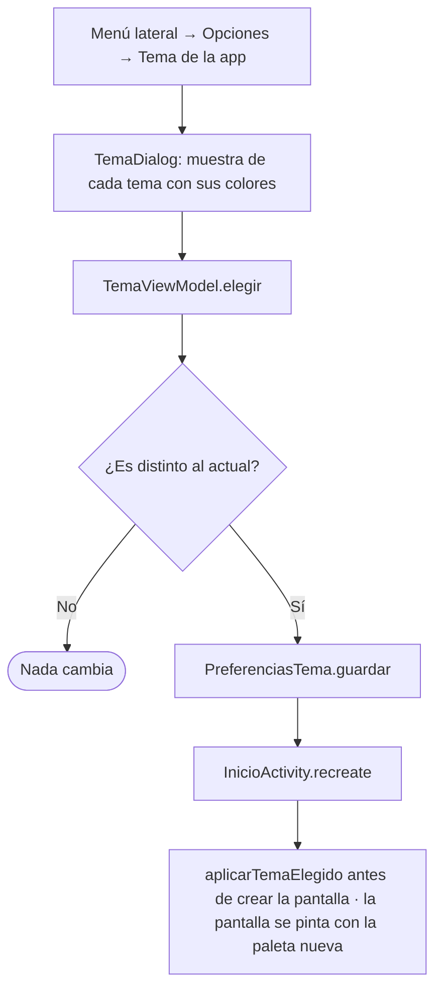

# EduPlanner - Diagrama de Actividades

Flujos principales tal como están implementados. Los nombres entre paréntesis son las clases que intervienen.

## 1. Inicio de sesión

## 2. Crear una tarea

## 3. Entregar y calificar una tarea

## 4. Predicción y recomendación de estudio

La asistencia se supone del 100 % hasta que haya suficientes clases confirmadas (`AsistenciaDialog`); nunca se le pide al estudiante.

## 5. Ver, editar, borrar y compartir

## 6. Recibir algo por QR

## 7. Gamificación

## 8. Notificaciones (con la app cerrada)

## 9. Cambiar el tema

