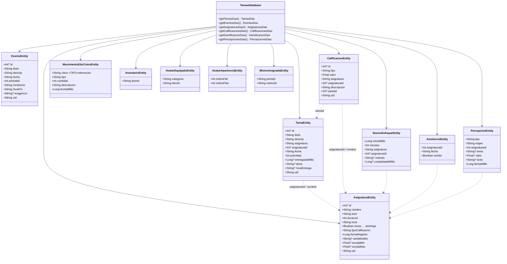
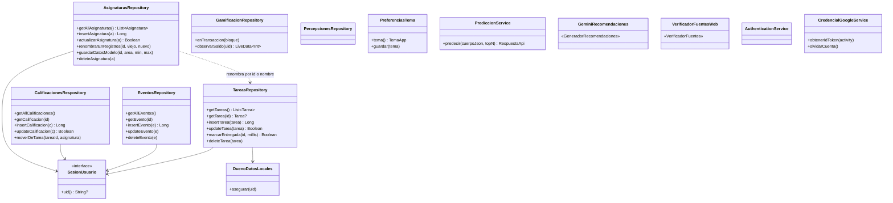
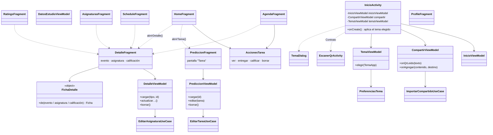

# Diagrama de Clases - EduPlanner

Clases principales y sus relaciones. Para no saturar, cada diagrama muestra un módulo; los campos y métodos son los relevantes, no todos. Todas las entidades llevan `uid` (dueño): los datos son por usuario.

## Datos (Room, base de datos versión 17)

## Repositorios y servicios

## Dominio

```mermaid
classDiagram
    class CrearAsignaturaUseCase {
        +invoke(NuevaAsignatura) ResultadoCrearAsignatura
    }
    class EditarTareaUseCase {
        +invoke(Tarea) ResultadoEdicion
    }
    class EditarAsignaturaUseCase {
        +invoke(id, NuevaAsignatura) ResultadoEdicion
    }
    class OtorgarRecompensaUseCase {
        +invoke(TipoRecompensa, referencia) ResultadoRecompensa
    }
    class EntregarTareaUseCase
    class CalificarTareaUseCase
    class EvaluarProgresoUseCase
    class ComprarAccesorioUseCase
    class ExtraerDatosPrediccionUseCase {
        +deTarea(Tarea) Extraccion
        +deAsignatura(id) Extraccion
    }
    class PredecirTareaUseCase
    class RecomendarTareaUseCase {
        +invoke(Tarea) ResultadoRecomendacion
    }
    class ImportarCompartidoUseCase {
        +analizar(contenido) AnalisisImportacion
        +importar(contenido, destino) ResultadoImportacion
    }
    class CodigoQr {
        <<object>>
        +codificar(ContenidoCompartido) String
        +leer(String) LecturaQr
    }
    class CatalogoModelo {
        <<object>>
        +detectarArea(nombre) DeteccionArea
        +METODOS_RECOMENDABLES
    }
    class TipoRecompensa {
        <<enum>>
        cantidad · topeDiario
    }
    class TemaApp {
        <<enum>>
        CLARO · OSCURO · AZUL · CLASICO
    }
    class ContenidoCompartido {
        <<sealed>>
        Tarea · Evento · Asignatura · Nota
    }

    CrearAsignaturaUseCase --> OtorgarRecompensaUseCase
    CrearAsignaturaUseCase --> CatalogoModelo
    EditarAsignaturaUseCase --> GamificacionRepository : transacción
    EditarTareaUseCase --> CalificacionesRespository
    EntregarTareaUseCase --> OtorgarRecompensaUseCase
    CalificarTareaUseCase --> OtorgarRecompensaUseCase
    OtorgarRecompensaUseCase --> TipoRecompensa
    RecomendarTareaUseCase --> ExtraerDatosPrediccionUseCase
    RecomendarTareaUseCase --> PredecirTareaUseCase
    RecomendarTareaUseCase --> GeminiRecomendaciones
    RecomendarTareaUseCase --> VerificadorFuentesWeb
    PredecirTareaUseCase --> PrediccionService
    ImportarCompartidoUseCase --> CrearAsignaturaUseCase
    ImportarCompartidoUseCase --> OtorgarRecompensaUseCase
    ImportarCompartidoUseCase --> ContenidoCompartido
    CodigoQr --> ContenidoCompartido
```

## Presentación

