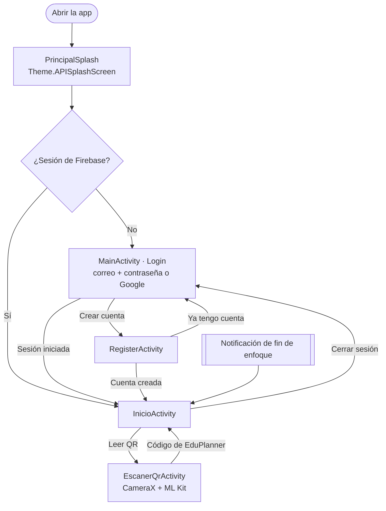

# EduPlanner - Mapa de Navegación

## Activities



Login, registro y pantalla de carga se ven siempre con el tema Claro. `InicioActivity` y `EscanerQrActivity` aplican el tema elegido en Opciones.

## Dentro de InicioActivity

`InicioActivity` contiene la cabecera (título, contador de EduCoins), el menú lateral, la barra inferior, el botón flotante y el `NavHost` (`nav_graph.xml`).

```mermaid
graph TD
    subgraph BARRA["Barra inferior"]
        B_HOME[Inicio] --> HOME
        B_AGENDA[Agenda] --> AGENDA
        B_HORARIO[Horario] --> HORARIO
        B_NOTAS[Notas] --> NOTAS
        B_PERFIL[Perfil] --> PERFIL
    end

    subgraph MENU["Menú lateral"]
        M_PRINC[Inicio · Agenda · Horario · Calificaciones · Asignaturas · Perfil y progreso]
        M_OPC["── Opciones ──"]
        M_TEMA[Tema de la app] --> TEMA_SHEET[[TemaDialog<br/>Claro · Oscuro · Azul · Clásico]]
        M_AYUDA[Ayuda y opiniones] --> AYUDA[HelpFragment]
        M_SALIR[Cerrar sesión]
        M_OPC --- M_TEMA --- M_AYUDA --- M_SALIR
    end

    subgraph FAB["Botón +"]
        F_TAREA[Añadir tarea] --> TAREA_FORM[[TareaDialog]]
        F_EVENTO[Añadir evento] --> EVENTO_FORM[[EventoDialog]]
        F_NOTA[Añadir calificación] --> NOTA_FORM[[CalificacionDialog]]
        F_QR[Leer QR] --> ESCANER_ACT[EscanerQrActivity] --> IMPORTAR[[ImportarCompartidoDialog]]
    end

    HOME[HomeFragment<br/>id_home_fragment]
    AGENDA[AgendaFragment<br/>id_diary_fragment]
    HORARIO[ScheduleFragment<br/>id_schedule_fragment]
    NOTAS[RatingsFragment<br/>id_ratings_fragment]
    ASIG[AsignaturasFragment<br/>id_subjects_fragment]
    PERFIL[ProfileFragment<br/>id_profile_fragment]

    TAREA_PANT[PrediccionFragment · "Tarea"<br/>id_prediction_fragment]
    DETALLE[DetalleFragment · "Evento / Asignatura / Calificación"<br/>id_detail_fragment]
    TIENDA[TiendaFragment<br/>id_shop_fragment]
    ENFOQUE[EnfoqueFragment<br/>id_focus_fragment]

    HOME -->|tocar tarea| TAREA_PANT
    HOME -->|tocar evento| DETALLE
    AGENDA -->|tocar tarea| TAREA_PANT
    AGENDA -->|tocar evento| DETALLE
    HORARIO -->|tocar clase| DETALLE
    ASIG -->|tocar asignatura| DETALLE
    NOTAS -->|tocar calificación| DETALLE
    PERFIL --> TIENDA
    PERFIL --> ENFOQUE

    HOME -->|menú ⋮ · Ver más| TAREA_PANT
    AGENDA -->|menú ⋮ · Ver más| TAREA_PANT
    TAREA_FORM -->|+ Agregar asignatura| ASIG_FORM[[AsignaturaDialog]] -->|vuelve con la asignatura elegida| TAREA_FORM
```

- **Pantalla de la tarea** (`PrediccionFragment`): tarjeta con el estado, la información de la tarea, los iconos editar · borrar · compartir y el botón Entregar (Calificar si ya se entregó); debajo, "Predicción y recomendaciones" (datos del modelo y recomendaciones de la IA). Se abre al tocar la tarjeta o con "Ver más" en su menú ⋮.
- **Pantalla de detalle** (`DetalleFragment`): la misma tarjeta para eventos, asignaturas y calificaciones (`TipoDetalle`). Editar abre el formulario de creación relleno; borrar pide confirmación y vuelve atrás.
- **Subpantallas** (`InicioActivity.SUBPANTALLAS`: tarea, detalle, tienda, enfoque): la cabecera muestra una flecha para volver. En la barra inferior queda marcada la pestaña desde la que se abrieron.
- **Perfil**: `ViewPager2` con las pestañas Misiones, Logros, Estadísticas y Avatar.

## Hojas y diálogos frecuentes

| Desde | Hoja | Para |
|---|---|---|
| Entregar una tarea | `Context.preguntar()` | "¿Ya tienes la calificación?" → `CalificarTareaDialog` o "Más tarde" |
| Datos para predicciones | `DatosEstudioDialogs` | Área, escala, tiempo y método, interés y dificultad |
| Cualquier tarjeta (compartir) | `CompartirQrDialog` | Mostrar el QR de una tarea, evento, asignatura o nota |
| Leer QR | `ImportarCompartidoDialog` | Confirmar, crear o reasignar la asignatura |
| Opciones | `TemaDialog` | Elegir el tema de la app |
| Gamificación | `LogroDialog`, `SubidaNivelDialog`, `RutaNivelesDialog`, `ConfirmarCompraDialog`, `AsistenciaDialog` | Celebraciones, niveles, compras y asistencia a clase |
